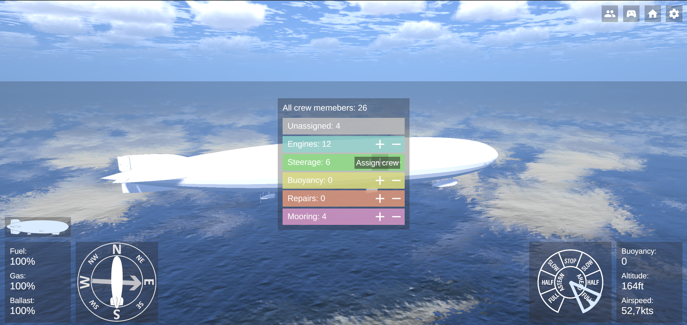
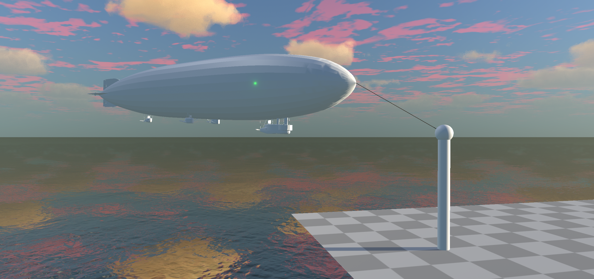
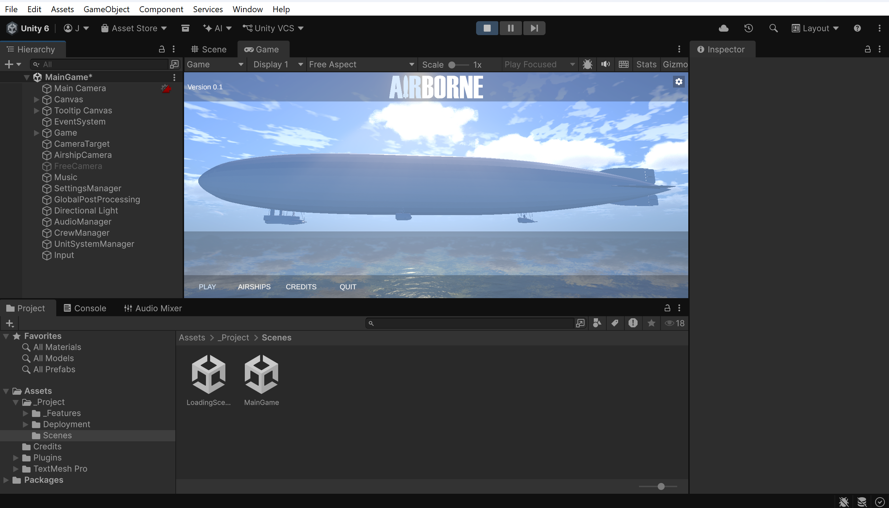
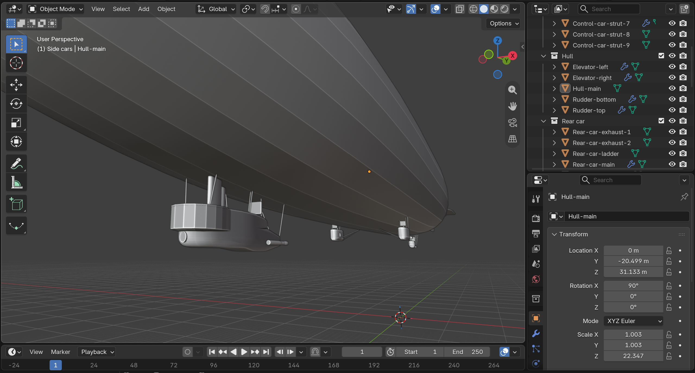

# AIRBORNE

⚠️ **Note:** This project is currently a **Work in Progress (WIP)** in an early development stage. Features may change, break, or be highly incomplete.

## 🌍 About

AIRBORNE is a hobby project created as a personal learning journey to master Unity and C#. It is a Unity-based open-world airship flight simulator, designed to provide both realistic simulation and enjoyable gameplay, aiming to feature real-life vehicles and locations from around the world.

## 🖼️ Gallery

<p align="center">
  <figure style="text-align: center;">
    
    <figcaption><i>Img.1. Interface: Temporary game UI and crew management menu.</i></figcaption>
  </figure>
</p>

<p align="center">
  <figure style="text-align: center;">
    
    <figcaption><i>Img.2. Gameplay: docking to a test mooring mast.</i></figcaption>
  </figure>
</p>

<p align="center">
  <figure style="text-align: center;">
    
    <figcaption><i>Img.3. Work in progress: The project opened in Unity editor.</i></figcaption>
  </figure>
</p>

<p align="center">
  <figure style="text-align: center;">
    
    <figcaption><i>Img.4. From Blender to Unity: Custom 3D airship modeling.</i></figcaption>
  </figure>
</p>

## 🗺️ Project Roadmap

This roadmap outlines the development milestones for AIRBORNE. Since the project is in an early stage, priorities may shift as learning progresses.

### Legend
* 🟩 **Done** – Feature is fully implemented and tested.
* 🟨 **In Progress** – Feature is currently being developed or refined.
* ⬜ **Planned / Backlog** – Feature is planned for future updates.

---

### Airship Mechanics
* 🟩 Buoyant physics (ballast and gas management)
* 🟩 Engine management
* 🟩 Steerage
* 🟨 Fuel consumption
* 🟨 Mooring to the mast
* 🟨 Damages & damage control
* ⬜ Spy basket
* ⬜ Scouting airplane – release & recovery
* ⬜ Missions & economy system

### Environment & Visuals
* 🟩 Skybox and day/night cycle ([Tenkoku](https://assetstore.unity.com/packages/tools/particles-effects/tenkoku-dynamic-sky-34435))
* 🟩 Water shader ([AQUAS-Lite](https://assetstore.unity.com/packages/vfx/shaders/aquas-lite-built-in-render-pipeline-53519))
* 🟨 Dynamic weather impact on airship handling
* 🟨 Prototype open-world test map
* ⬜ Real-world locations and structures

### Systems & Features
* 🟩 Crew management
* 🟩 Third-person and free-camera modes
* 🟨 Vehicle tree system for switching between different airships
* 🟨 Locations system for choosing different starting locations
* ⬜ Multiple variants of some vehicles


## 🚀 Prerequisites & Installation

This project is built using **Unity 6000.3.24f1**. To properly set up and run the project locally, please follow the steps below.

### 1. Clone the Repository
```bash
git clone https://github.com/Julian9B/airborne.git
cd airborne
```

### 2. Restore Missing Assets (Important)
To keep the repository clean, the `Assets/Plugins` folder is ignored by git. Before opening the project in Unity, you must manually download and import the following external packages from the Unity Asset Store into your `Assets/Plugins` directory:
* [**AQUAS-Lite**](https://assetstore.unity.com/packages/vfx/shaders/aquas-lite-built-in-render-pipeline-53519)
* [**TENKOKU Dynamic Sky**](https://assetstore.unity.com/packages/tools/particles-effects/tenkoku-dynamic-sky-34435)

Failure to do so will result in missing script references and broken scene environments.

## 📃 Third-Party Credits & Licenses

* This project is licensed under the **MIT License** – see the [LICENSE](LICENSE) file for details.
* Project dependencies, credits, and open-source licenses are maintained in the [CREDITS.md](Assets/Credits/CREDITS.md) file.
* Please note that certain asset licenses (such as fonts) are included directly within their respective asset directories rather than the central credits file.
